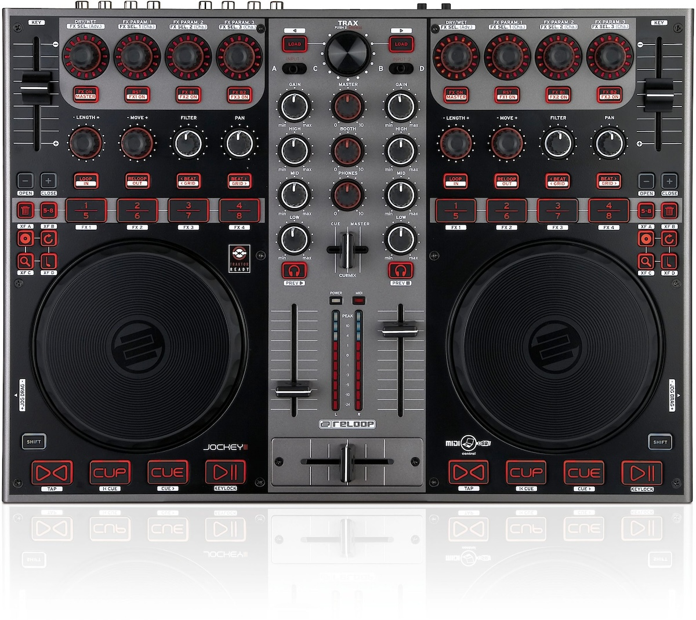
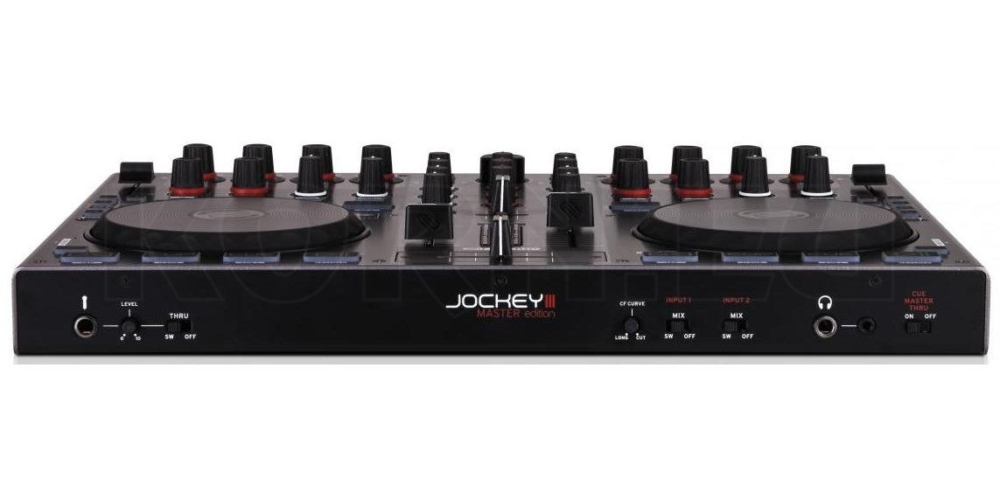
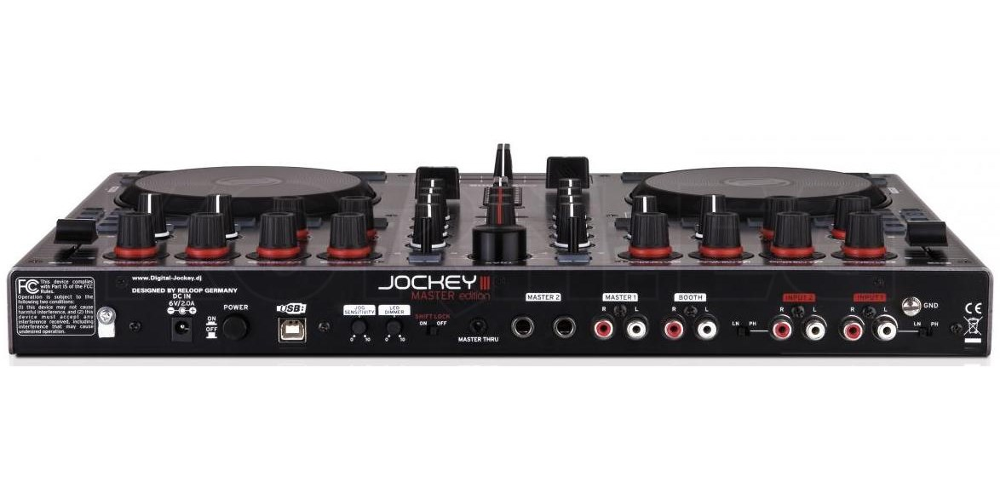

# Reloop Jockey 3 ME macOS Bridge

<table>
  <tr>
    <td>
      
    </td>
    <td>
      <br>
      
    </td>
  </tr>
</table>

A reverse-engineered macOS audio + bidirectional MIDI bridge for the **Reloop Jockey 3 ME**, with live-tested Traktor Controller Manager mappings.

The bridge talks directly to the controller over USB, exposes a CoreMIDI endpoint to Traktor, and routes Traktor audio through BlackHole to the Jockey 3 ME at 48 kHz.

## Current live-tested baseline

| Component | Current version / setting |
|---|---|
| Bridge engine | **v8.0.8** |
| Qualified development baseline | **v8.1.8 Candidate 1** |
| Bridge supervisor | **v8.1.8 event-driven IOKit supervisor** |
| Spotlight guard | **v8.1.7 event-driven helper** |
| Reduce Motion / Traktor lifecycle guard | **v8.1.7 event-driven WatchGuard** |
| Latest published release | **v8.1.7** |
| Traktor observed | **3.11.1.17** |
| Tested OS | **macOS Sonoma 14.8.9, Apple Silicon** |
| Controller firmware observed | **1.0.6** |
| Traktor sample rate | **48 kHz** |
| Traktor audio buffer size | **512 samples** |
| Traktor Multi-Core Processing | **OFF** |
| Traktor mapping | **Five mapping-only Controller Manager exports** |
| Mapping checksums | `checksums/MAPPING_ONLY_SHA256SUMS.txt` |

Qualified engine binary SHA-256:

`66355176b2bc4193e4a749c72a56ab48771b71ed91d1cb8f638fd924961618a4`

Exact physically-qualified v8.1.7 Candidate 7 ZIP SHA-256:

`8ebc35f548ec231c64214f68a7e481d5885d093e1b10ce2cfbfde6a0b48a801d`

Qualified v8.1.8 Candidate 1 ZIP SHA-256:

`853f29e6decfbb5291ae292ec9e43570ce0e146a48fee345999534024e9d837b`

v8.1.8 replaces the final one-second controller-presence polling loop with event-driven IOKit USB arrival/removal notifications plus one event-driven wake reconciliation. Power-cycle, physical USB unplug/replug, sleep/wake and Traktor/audio qualification passed on the physical setup. v8.1.8 is checkpointed in GitHub as the qualified development baseline but is not yet published as a GitHub Release.

Candidate 7 passed the full installer/reversible-state QA and then completed approximately one hour of live DJ operation on 23 October 2026. The reported result was clean: no crackling, no popping, no audio dropouts and no observed bridge/control failure.

See `docs/QUALIFIED_RUNTIME_SETTINGS_v8_1_8.md`, `docs/V8_1_8_EVENT_DRIVEN_USB_SUPERVISOR.md`, and the published v8.1.7 release notes.

## What the bridge does

- Sends 48 kHz audio to the Reloop Jockey 3 ME.
- Routes Traktor Master L/R from BlackHole channels 1/2.
- Routes Traktor Monitor L/R from BlackHole channels 4/3.
- Exposes `Reloop Jockey 3 ME (Bridge)` as a bidirectional CoreMIDI endpoint.
- Tracks the actual Tempo Master for Deck A/B.
- Flashes the actual master's trash LED with Beat Phase.
- Mirrors that Beat Phase to the actual master's Play/Pause LED.
- Restores normal Play/Pause LED state when master status moves away.
- v8.0.8 includes Phase 4 USB/MIDI diagnostics and a bounded recovery path for the catastrophic zero-byte USB failure class.

The bounded catastrophic-recovery path has **not yet been exercised in a reproduced catastrophic event**. Successful normal-operation qualification is not proof of that specific recovery path.

## Automatic Traktor-time macOS controls — v8.1.7

v8.1.7 changes the automation layer without changing the qualified bridge engine or bridge-supervisor behavior.

### Event-driven lifecycle detection

The per-user LaunchAgent:

`com.guy.reloopbridge.watchguard`

subscribes to macOS NSWorkspace launch and termination events for Traktor. It performs one startup reconciliation for recovery and otherwise sleeps in its run loop. There is no recurring Traktor process-detection timer in the new automation layer.

### Spotlight

The root LaunchDaemon remains:

`com.guy.reloopbridge.spotlightguard`

but its implementation is now event-driven. It blocks on an authenticated Unix-domain socket and runs `mdutil` only for state transitions or recovery. The old recurring Spotlight status loop is removed.

### Reduce Motion

The same WatchGuard manages Reduce Motion. It keeps the effective-state write/refresh mechanism that was already live-proven in v8.1.6, but removes the v8.1.6 two-second Traktor polling loop.

### State-safety rule

For both Spotlight and Reduce Motion:

- save the original state before changing it;
- if already at the DJ target, do not write;
- otherwise change once and verify;
- on Traktor exit, compare against the saved original;
- if already restored, do not write;
- otherwise restore once and verify;
- keep durable recovery state until restoration is confirmed.

The WatchGuard also uses a save barrier: both original states must be safely persisted before either DJ-state change is applied.

See `docs/V8_1_7_EVENT_DRIVEN_GUARDS.md`.

## Exact release promotion

The v8.1.7 GitHub Release publishes the **exact Candidate 7 ZIP that was physically qualified**, byte-for-byte. The workflow verifies its SHA-256 before publication.

The package intentionally retains its internal `8.1.7-candidate7` identifier rather than rebuilding after qualification merely to change a version label.

## Mapping scope

The five files under `mapping/` are mapping-only exports. They do not contain global Traktor preferences, audio settings, playlists, personal paths or unrelated controllers.

Current Deck A/B additions include:

- RELOOP button -> Mixer Low Kill, including matching LED OUT;
- Deck B XFA–XFD -> Deck D Remix slots 1–4 Slot Retrigger while Deck B remains selected;
- Deck A/B FX Unit 4 versus Browser/Load physical-button assignments swapped for improved playing accessibility.

The mappings also contain project workflow choices such as Favorites browsing, Recorder/Cruise assignments and Deck C/D behavior. Those choices are not requirements of the bridge itself.

See `docs/CURRENT_MAPPING_SPEC.md`.

## Repository layout

```text
src/        qualified and experimental Objective-C bridge source
service/    historical production service/helper artifacts
release/    exact physically-qualified release artifacts and source snapshots
mapping/    five current mapping-only Controller Manager exports
patches/    source-level bridge diffs
tools/      mapping, Phase 4 diagnostic and release tooling
docs/       setup, qualification, release and engineering documentation
checksums/  SHA-256 records
```

## Installation scope

The v8.1.7 release asset is the exact package qualified on the original Mac. It is intended for that existing qualified environment, not as a generic fresh-machine installer.

For details, see `docs/RELEASE_PACKAGE_README_v8_1_7.md`.

## Current release notes

See:

`docs/RELEASE_NOTES_v8_1_7.md`

## Engineering rule

Structural validation, runtime evidence and live hardware qualification are kept separate. A successful compile or parser pass is not described as physical qualification.

`main` is the current accepted baseline. Experimental work belongs on development branches until it has been accepted for promotion.

## Public status

The repository is public. The public-readiness record is in `docs/PUBLIC_READINESS.md`.

Licensed under the **MIT License**. See `LICENSE`.


